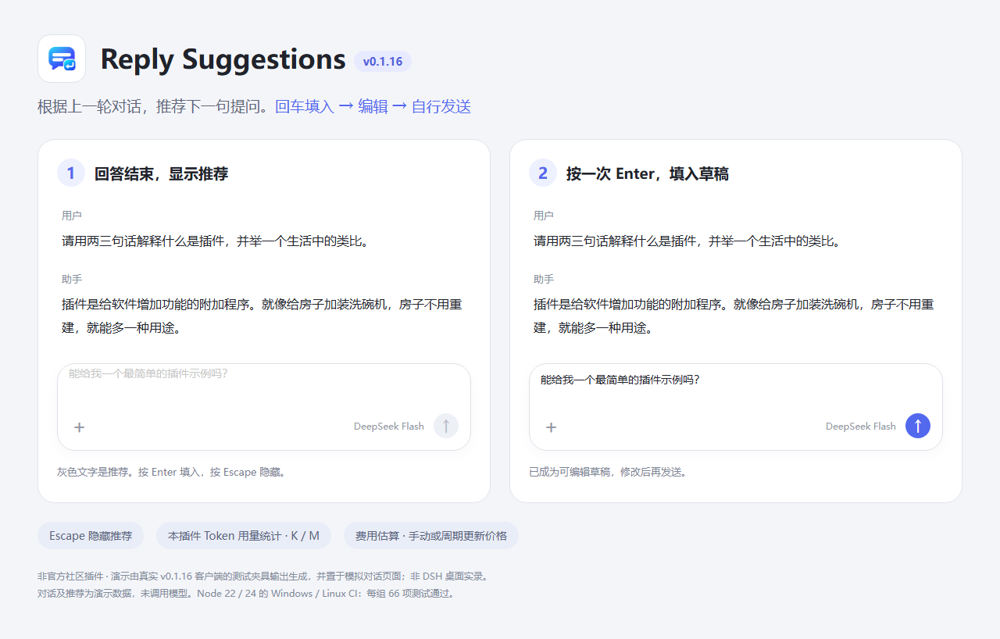

# Reply Suggestions

**简体中文** · [English](./README_EN.md)

根据上一轮对话，自动推荐下一句提问。回车填入，编辑后再发送。

一个为 [DeepSeek Harness](https://github.com/deepseek-ai/deepseek-harness) 提供输入框推荐的插件。助手回答结束后，输入框为空时显示灰色推荐；按回车将它变成可编辑的草稿，不会自动发送。

| 项目 | 当前版本 |
| --- | --- |
| 插件 | `0.1.17` |
| 已核对的官方桌面版 | `0.2.0-rc.2`、`0.2.1-rc.2` |
| 许可证 | [MIT](./LICENSE) |

## 功能

- 根据最近一次用户问题和助手回答，生成一条相关的后续提问。
- 第一次按 **Enter** 把推荐填入草稿，可继续编辑；之后按 Harness 原有规则发送。
- 按 **Escape** 隐藏当前推荐。
- 保留中文输入法确认和 Shift/Ctrl/Command/Alt+Enter 的原有行为。
- 输入框有草稿、附件、引用或待处理队列时延后生成；任务运行时不显示推荐。
- 使用 Harness 已配置的模型和凭据，不需要另填 API Key。
- 在插件详情页查看历史总量、今天、昨天、近 7 天和近 30 天的推荐 Token 用量及人民币费用估算。
- 在详情页点击“更新价格”，或默认每 7 天自动检查官方价格表。

## 演示



演示由真实 0.1.16 客户端的测试夹具输出生成，并置于模拟对话页面；非 DSH 桌面实录。对话和推荐为演示数据，没有调用模型。

## 安装

### 从 GitHub 安装

1. 打开 DSH 的 **插件** 页面，先检查是否已安装 `dsh-reply-suggestions`。已安装时使用更新入口，避免重复添加。
2. 确认官方桌面版为 `0.2.0-rc.2` 或 `0.2.1-rc.2`。
3. 点击 **添加插件**，在“包名或地址”中填写：

   ```text
   https://github.com/jabingu/dsh-reply-suggestions
   ```

4. 按应用提示完成加载并启用，重启 DSH。
5. 完成一次普通对话，保持输入框为空，等待灰色推荐出现。

仓库包含构建好的 `lib/`，安装前无需自行构建。DSH peer 声明支持 `0.2.0-rc.2` 和 `0.2.1-rc.2`；其他版本需要先核对接口。

如果升级到 DSH `0.2.1-rc.2` 后看到 `0.1.16` 的不兼容提示，将插件更新到 `0.1.17`，再完全退出并重启 DSH。本地链接安装只需更新链接目录中的文件后重启，已有用量记录继续保留。

### 从本地目录安装

下载仓库 ZIP 并解压，或克隆仓库。检查插件尚未安装后，在同一添加入口填写包含 `package.json` 的目录绝对路径，启用后重启 DSH。

官方桌面 profile 由应用管理，请使用桌面插件页面。确实使用 `dsh web` 的用户可在插件目录执行：

```powershell
dsh plugin --profile web list --depth=0
# 确认尚未安装后再添加：
dsh plugin --profile web add .
```

更新本地链接安装时，更新已链接目录中的文件并重启 DSH 即可，无需重复安装。

## 使用示例

发送：

> 请用两三句话解释什么是插件，并举一个生活中的类比。不要调用工具或创建文件。

回答完成后，可能出现“能给我一个最简单的插件示例吗？”的灰色推荐。按一次 Enter 填入，修改后再发送。具体内容由模型生成，随对话变化。

## 模型与 token 消耗

每次生成推荐会额外调用一次模型，即使没有采用推荐，也已产生该次请求的用量。默认沿用助手回答记录的 provider/model；rc.2 记录缺少元数据时，使用会话当前模型投影。

插件通过以下方式限制开销：

- 只读取上一轮正文，不传整段历史、推理块或附件内容。
- 用户问题最多 **400 个字符**，助手回答最多 **1,200 个字符**；客户端和 Host 均执行限制。
- 长文本保留约前三分之一和后三分之二，中段标记省略；Markdown 围栏代码块在本地省略，保留周围说明及行内代码。
- 使用较短提示词，输出上限为 **96 token**；此上限不包含输入 token。
- DeepSeek 的推荐请求关闭深度思考，不改变主对话的推理设置。
- 输入框可用且空闲 **800 毫秒**后才请求；等待期间开始输入会取消定时器。
- 已发起请求后输入文字会暂时隐藏推荐，结果可在清空草稿后复用，避免取消重试。切换会话、开始新一轮或卸载仍取消旧请求。
- Host 最多缓存 64 条已完成结果，最多同时生成两条推荐。

相比旧版，上下文上限从 14,000 降到 1,600 字符，减少约 88.6%；这不是每次实际 token 的节省比例。压缩可能让推荐忽略回答中段和代码细节。插件不额外调用模型进行摘要。

## 用量统计

打开 **插件 → Reply Suggestions**，可查看历史总量及四个时间范围的已记录 Token、输入（含模型缓存）/输出 Token、请求次数，以及未返回用量、失败和取消的请求次数。

“历史总量”汇总开始记录以来的全部有效请求，包括超过 30 天的记录；直接按请求去重汇总，不把四个重叠时间范围相加。费用按每次请求保存的价格估算，缺少用量或价格时标明未知/部分；开始记录前没有保存的历史无法补回。

统计精简为两张卡片：左侧默认显示今天，可通过下拉菜单切换昨天、近 7 天或近 30 天；右侧固定显示历史总量。切换直接使用已读取的数据，不增加模型或统计请求。

Token 数量自动显示 K（千）、M（百万），最多保留两位小数，例如 `12K`、`1.23M`；不足一千显示整数。总量与输入/输出均采用此格式，实际记录和费用计算仍使用完整 Token 数。

- 使用 DSH 模型流返回的实际 `usage`，不把字符估算当成真实 Token。
- 近 7 天、近 30 天包含今天，按 DSH Host 的本机时区和自然日汇总。
- 只记录本插件生成推荐的请求，不统计主对话、其他插件或查看统计的 RPC。
- 本插件复用已生成推荐时没有新模型请求，不重复计数；提供方报告的缓存 Token 仍包含在输入统计内。
- 一次请求收到多条累计用量，只保存最后一条有效用量，不累加重复快照。失败/取消时已返回的用量也计入；未返回用量则标注为“未知”，不假定为零。
- 数据在重启后保留，记录开始时间也会显示。升级前没有记录的历史无法补回。
- 页面打开时每 15 秒刷新，也可手动点击“刷新”；刷新不会调用模型。

记录保存在 Harness 数据目录的 `storages/dsh-reply-suggestions/usage.jsonl`，遵循 `DSH_HOME`，默认位于 `~/.dsh`。不同 profile 使用同一数据目录时共享本插件的统计。文件保存记录编号、时间、请求状态、Token 数；从 0.1.8 起还保存实际请求的 provider/model 和价格版本，不保存对话正文、附件或凭据。无法保存或读取记录时，页面会标明统计可能不完整。

### 费用估算

每张卡片显示人民币 API 公开价估算，范围为空闲价～高峰价。读取用量仅使用本地价格；更新价格时直接读取官方网页，不调用模型。以下为插件内置的 [DeepSeek 官方价格](https://api-docs.deepseek.com/zh-cn/quick_start/pricing)，核对日期 2026-10-14，单位为元/百万 Token；联网成功后新请求使用获取到的价格：

| 模型 | 输入未命中（空闲/高峰） | 输入缓存命中（空闲/高峰） | 输出（空闲/高峰） |
| --- | --- | --- | --- |
| Flash | 1 / 2 | 0.02 / 0.04 | 4 / 8 |
| Pro | 4.5 / 9 | 0.15 / 0.30 | 13.5 / 27 |

费用 =（输入减缓存命中）×输入单价 + 缓存命中×缓存单价 + 输出×输出单价，再除以一百万。范围不推测中国法定节假日，不代表实际账单、赠送额度或套餐扣费。

- 官方 `deepseek` / `deepseek-account` 的 Flash、Pro 使用各自价格；Flash 的官方兼容名称使用 Flash 价。其他 provider/model 不套用此价格，标记为未计入费用。
- 0.1.6/0.1.7 的记录缺少模型名称，保留原记录，并明确标注“历史请求按 Flash 假设估算”。如果当时使用其他模型，此部分金额不适用。
- 未返回用量、价格未知或记录早于对应价格生效日的请求不估算，不当成免费；部分可计算时显示“部分”。费用范围按每条记录计算后汇总。
- 新请求在生成推荐前保存完整价格快照，即使生成期间调价，仍按开始请求时的价格估算。更新不会重新计算旧请求的价格；0.1.8 的旧价格版本继续保留。
- 微小费用保留最多六位小数，低于 ¥0.000001 的非零费用仍显示“小于 ¥0.000001”。

### 更新价格

在 **插件 → Reply Suggestions → 推荐 Token 用量** 下方点击 **更新价格**，立即检查官方人民币价格表。它与“刷新”按钮独立：刷新只读取用量，更新价格才会访问网页。页面显示上次成功检查、下次检查及失败原因。

在“自动更新周期”下拉框选择 **每天、每 3 天、每周（7 天）、每 30 天、仅手动更新**。选择后自动保存并生效，重启后保留。保存失败时保留原周期；选择“仅手动更新”仍可点击“更新价格”。

- 默认每 7 天检查；Host 每小时判断是否到期。首次启动或到期后重启会立即补检查，DSH 关闭期间不运行。
- 自动更新失败后等 24 小时再重试，手动按钮随时可重试；同一 Host 中同时触发的更新共用一次请求。
- 仅访问官方价格页的规范地址 `https://api-docs.deepseek.com/zh-cn/quick_start/pricing/`，15 秒超时，不使用 API 密钥、不发送对话、不跟随跳转。
- 严格解析 Flash/Pro、人民币、每百万 Token、输入未命中/缓存命中/输出及空闲/高峰价格。网络不可用、币种/单位不符、字段缺失或页面结构变化时保留已有价格，并提示失败。
- 缓存及检查结果追加保存到 Harness 数据目录的 `storages/dsh-reply-suggestions/prices.jsonl`；重启后恢复，避免重复检查。价格无法落盘时会提示当前价格可能仅在本次运行有效。
- 未在详情页选择过周期时，使用配置中的 `autoUpdatePrices` / `priceUpdateDays`（默认每 7 天，允许 1～30 天）。详情页保存的选择优先于这些初始配置，随 `prices.jsonl` 恢复；共享同一数据目录的 profile 也共享这项选择。

## 可选配置

一般无需配置。如需指定其他已在 Harness 配置好的模型，可在使用中的 profile 的 `cordis.patch.yml` 中覆盖：

```yaml
- id: reply-suggestions
  config:
    enabled: true
    timeoutMs: 20000
    autoUpdatePrices: true
    priceUpdateDays: 7
    provider: your-configured-provider
    model: your-configured-model
```

| 配置 | 默认值 | 说明 |
| --- | --- | --- |
| `enabled` | `true` | 是否生成推荐 |
| `timeoutMs` | `20000` | 超时毫秒数，允许 1,000～60,000 |
| `provider` | 跟随对话 | 可选，必须是已配置的提供方 |
| `model` | 跟随对话 | 可选，必须是该提供方可用的模型 |
| `autoUpdatePrices` | `true` | 自动检查价格；设为 `false` 时仍可手动更新 |
| `priceUpdateDays` | `7` | 自动检查周期，1～30 天；失败后 24 小时重试 |

失败、超时或输出不符合要求时，输入框保留普通行为。可在客户端控制台查找 `[reply-suggestions]` 诊断。

## 开发

开发要求 Node.js 22 或更高版本。已在 Windows x64 的 Node 22.23.3 和 24.16.0 上实际验证，无需安装构建依赖：

```powershell
npm run build
npm test
```

`npm test` 自动枚举测试文件，避免 Node 22 和 Windows 下通配符展开的差异；可使用 `npm test -- --test-reporter=dot` 显示简洁结果。

[Node compatibility](./.github/workflows/test.yml) 工作流在 push、pull request 和手动触发时，分别在 Windows、Linux 上测试 Node 22 和 24。每个任务执行构建、构建产物一致性检查、全部测试、客户端语法检查及 `npm pack`。工作流随代码推送到 GitHub 后生效；本地验证不代表云端任务已经运行。

桌面插件使用 DSH 内置运行环境，以上 Node 测试不替代桌面视觉和输入法验收。

```text
src/common.mjs       RPC 契约、上下文压缩、键盘保护
src/engine.mjs       模型请求、预算、缓存与超时
src/usage.mjs        持久化用量记录和自然日汇总
src/pricing.mjs      官方人民币价格版本及费用范围计算
src/price-updates.mjs 官方网页解析、定期检查与价格缓存
src/index.mjs        Host 服务注册
src/client.cjs       灰色推荐、生成时机、草稿填入
lib/                 已构建的 Host 和客户端文件
locale/              插件名称和中英文介绍
scripts/build.mjs    无额外构建依赖的打包脚本
scripts/test.mjs     跨平台测试文件枚举及运行脚本
.github/workflows/test.yml Node 22/24 的 Windows/Linux 自动测试
tests/               行为和客户端生命周期测试
```

实现使用官方 Typert/Gateway RPC、`llm.stream`、`conversation.input.overlay` 槽位、会话快照和草稿动作。已核对两个支持版本的 composer DOM 标记、草稿动作及详情页槽位，版本变更时需要重新检查。

## 验证范围

- `0.1.17` 修正 `0.1.16` 精确锁定旧 DSH 版本造成的加载拦截，明确兼容 `0.2.0-rc.2` 和 `0.2.1-rc.2`。使用新版 DSH 自带的兼容性检查代码验证通过；已用新版 Cordis、Typert、Host/Client Gateway 和 home-paths 检查推荐、用量、费用、价格更新、周期保存及重启恢复。模型和网络采用测试替身，不改真实记录；未重新完成新版桌面视觉及真人输入法验收。
- Node 22.23.3 和 24.16.0 分别通过 66 项自动化测试，覆盖推荐交互、占位节点生命周期、用量及历史总量去重、日期边界、费用计算、价格更新及周期保存、失败回退、重启恢复和统计页面卸载。0.1.17 验证日期：2026-10-18。
- `0.1.16` 修复并发相同请求重复调用模型、输入框重复挂载产生重叠推荐，以及损坏价格缓存警告被错误清除的问题。两个 Node 版本均通过真实 rc.2 库的 RPC、缓存计数及重启恢复检查，模型使用 stub；桌面视觉验收仍需单独完成。
- 使用官方 rc.2 安装包中的 Cordis、Typert 和 Host/Client Gateway，验证了实际插件 fiber 的挂载、RPC 和卸载，模型使用 stub。
- `0.1.2` 曾在真实 rc.2 桌面端验证推荐生成、显示、首次 Enter 填入、编辑、Shift+Enter 换行、发送、Escape 和会话切换。
- `0.1.3` 的用量优化及 `0.1.4` 的展示元数据更新已通过自动化和资源检查；没有重新进行真实模型质量或桌面视觉验收。
- `0.1.5` 增加透明 PNG 对话图标，已核对尺寸、透明通道、256 KB 限制和打包清单；未改动推荐或快捷键逻辑。
- `0.1.6` 已用官方 rc.2 Cordis、Typert、Gateway 和 SlotCore 检查用量 RPC、详情页注册及缓存计数；真实桌面详情页显示四个统计卡片，并核对了一条实际推荐的 223 Token 与本地记录一致。刷新统计未增加模型请求。
- `0.1.7` 将占位文字隐藏样式移入输入框组件，并用内联样式隐藏辅助提示，修复返回旧对话时提示文字与占位文字重叠。
- `0.1.8` 加入人民币费用范围估算，真实历史 911 Token（输入 844、输出 67）按 Flash 假设得到 ¥0.001112～¥0.002224；官方 rc.2 RPC 检查和统计组件测试通过，尚未重新进行本版本的桌面视觉验收。
- `0.1.9` 加入手动/周期更新：真实访问官方页面、价格保存及重新加载成功；真实 rc.2 Gateway 验证更新按钮对应 RPC，统计与价格检查不增加模型调用。未重新进行桌面视觉验收。
- `0.1.10` 将总量及输入/输出 Token 自动缩写为 K/M，最多两位小数。
- `0.1.11` 在详情页增加自动更新周期选择；真实 rc.2 RPC 验证保存及 Host 重启恢复，失败保持旧设置。未重新进行桌面视觉验收。
- `0.1.12` 直接隐藏实际占位节点并观察重建，组件之间共用隐藏租约，避免旧实例卸载恢复新实例仍需隐藏的占位文字。已实际验证重启、插件页返回及历史对话切换，观察到单条推荐且无占位文字重叠。
- `0.1.13` 加入历史总量卡片，汇总全部有效记录并沿用 K/M 显示及历史价格。超过 30 天、重复、未知、异常和未来记录测试通过；真实 rc.2 RPC 与 Host 重启恢复验证通过。未重新进行本版本桌面视觉验收。

其他 Harness 版本、第三方桌面壳和真人输入法选词需要另行实测。模型生成的推荐可以修改或忽略。

## 许可证

[MIT](./LICENSE)
